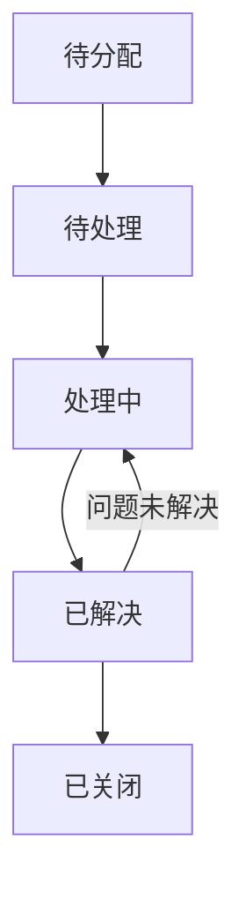

# 工单管理系统产品需求文档（PRD）

| 文档属性 | 内容 |
| --- | --- |
| 项目名称 | 工单管理系统（Ticket Management System） |
| 文档版本 | v1.0 |
| 产品阶段 | MVP |
| 文档状态 | 初稿 |
| 技术架构 | 单体应用 |

## 1. 产品定位

本产品是一个面向企业、组织及中小型团队的工单管理系统，用于统一管理问题反馈、服务请求、故障报修及任务处理。

通过标准化的工单处理流程，实现问题提交、工单分配、问题处理、沟通反馈、处理完成和历史追溯的业务闭环。

### 1.1 产品目标

- 提供统一的问题提交入口。
- 明确工单负责人和处理进度。
- 降低用户与处理人员之间的沟通成本。
- 实现工单处理过程可追溯。
- 为后续数据统计、知识库和 AI 能力提供基础。

### 1.2 产品设计原则

- MVP 优先：优先实现核心业务功能。
- 简单实用：避免不必要的业务及技术复杂度。
- 权限明确：不同角色拥有不同操作权限。
- 过程可追溯：记录关键业务操作。
- 渐进式扩展：核心业务稳定后逐步增加功能。

## 2. 目标用户

| 用户角色 | 角色说明 | 核心需求 |
| --- | --- | --- |
| 普通用户（USER） | 提交问题或服务请求的人员 | 创建工单、查看进度、发表评论 |
| 处理人员（AGENT） | 负责解决工单问题的人员 | 查看分配给自己的工单、更新状态、回复评论 |
| 管理员（ADMIN） | 负责系统管理及工单调度的人员 | 管理用户、分配工单、查看全部工单 |

典型适用场景包括企业内部 IT 支持、售后服务、设备报修及内部问题反馈。

## 3. 核心业务场景

### 3.1 用户提交工单

1. 用户注册并登录系统。
2. 填写工单标题、问题描述及优先级。
3. 提交工单。
4. 系统将工单初始化为待分配状态。
5. 用户可以查看自己提交的工单。

### 3.2 管理员分配工单

1. 管理员查看待分配工单。
2. 选择处理人员并分配工单。
3. 系统将工单状态更新为待处理。
4. 系统记录负责人及状态变化。

### 3.3 处理人员处理工单

1. 处理人员查看分配给自己的工单。
2. 开始处理并更新工单状态。
3. 通过评论与用户沟通。
4. 问题解决后，将工单标记为已解决。

### 3.4 用户确认处理结果

1. 用户查看处理结果。
2. 确认问题已解决后关闭工单。
3. 如果问题尚未解决，可将已解决工单退回处理中。
4. 系统记录状态变化。

## 4. 功能范围及优先级

- P0：第一版必须实现，是 MVP 发布的必要条件。
- P1：核心功能完成后再实现。
- P2：后期扩展功能。

| 模块 | 功能 | 优先级 |
| --- | --- | --- |
| 用户认证 | 注册、登录、退出 | P0 |
| 用户管理 | 用户列表、用户详情 | P0 |
| 工单管理 | 创建、查询、修改、删除 | P0 |
| 工单分配 | 管理员分配处理人员 | P0 |
| 工单状态 | 状态流转 | P0 |
| 工单评论 | 用户与处理人员交流 | P0 |
| 操作记录 | 记录工单状态及负责人变化 | P0 |
| 数据统计 | 工单数量、状态分布 | P1 |
| 知识库 | 文章管理、搜索 | P1 |
| 消息通知 | 站内消息、未读提醒 | P1 |
| AI 功能 | 智能分类、知识库问答 | P2 |

## 5. P0 功能需求

### 5.1 用户认证

- 支持账号注册、登录和退出。
- 注册账号默认拥有普通用户角色。
- 密码必须以安全哈希形式存储。
- 未登录用户不得访问受保护的业务资源。
- 管理员及处理人员的初始化方式由技术设计阶段确定，不开放自行注册为特权角色。

### 5.2 用户管理

- 管理员可以查看用户列表和用户详情。
- 用户信息包含唯一标识、账号、显示名称、角色及创建时间。
- 不展示密码或密码哈希。
- MVP 暂不提供完整的角色及权限配置后台。

### 5.3 工单管理

工单基础信息：

| 字段 | 说明 |
| --- | --- |
| 工单编号 | 系统生成的唯一标识 |
| 标题 | 问题简要说明，必填 |
| 描述 | 问题详细说明，必填 |
| 优先级 | 低、普通、高，默认普通 |
| 状态 | 当前处理阶段 |
| 创建人 | 提交工单的用户 |
| 负责人 | 当前处理人员，初始为空 |
| 创建时间 | 工单创建时间 |
| 更新时间 | 最近一次更新时间 |

业务规则：

- 普通用户可以创建工单，并查看自己提交的工单。
- 普通用户仅可修改自己尚未分配的工单标题、描述及优先级。
- 处理人员可以查看分配给自己的工单。
- 管理员可以查看、修改全部有效工单。
- 删除功能采用逻辑删除，仅管理员可删除工单。
- 已删除工单不出现在普通业务查询中，历史评论与操作记录予以保留。
- 工单列表支持按状态筛选和标题关键字搜索，并支持分页。

### 5.4 工单分配

- 仅管理员可以分配或更换负责人。
- 负责人必须是处理人员角色。
- 首次分配成功后，状态由待分配变为待处理。
- 待处理和处理中的工单允许重新分配，原状态保持不变。
- 每次负责人变化均需生成操作记录。

### 5.5 工单状态

| 状态 | 状态标识 | 说明 |
| --- | --- | --- |
| 待分配 | OPEN | 工单已提交，尚未分配人员 |
| 待处理 | ASSIGNED | 已分配人员，尚未开始处理 |
| 处理中 | IN_PROGRESS | 处理人员正在解决问题 |
| 已解决 | RESOLVED | 问题已处理，等待确认 |
| 已关闭 | CLOSED | 工单处理结束 |

标准流程：

状态流转规则：

| 当前状态 | 目标状态 | 操作角色 |
| --- | --- | --- |
| 待分配 | 待处理 | 管理员（分配时自动更新） |
| 待处理 | 处理中 | 当前负责人、管理员 |
| 处理中 | 已解决 | 当前负责人、管理员 |
| 已解决 | 已关闭 | 创建人、管理员 |
| 已解决 | 处理中 | 创建人、管理员 |

禁止未经定义的状态流转。已关闭工单为终态，不允许重新打开。

### 5.6 工单评论

- 工单创建人、当前负责人及管理员可以查看和发表评论。
- 评论包含内容、发表评论的用户及时间。
- 评论按时间顺序展示。
- 已关闭工单仅允许查看历史评论。
- MVP 仅支持纯文本评论，不支持附件、富文本及评论编辑删除。

### 5.7 操作记录

系统自动记录工单状态变化和负责人变化。

每条操作记录包含：

- 关联工单。
- 操作人。
- 操作类型。
- 变更前的值。
- 变更后的值。
- 操作时间。

有权查看工单的用户可以查看该工单的操作记录。操作记录不提供手动修改或删除入口。

## 6. 角色权限矩阵

| 操作 | 普通用户 | 处理人员 | 管理员 |
| --- | --- | --- | --- |
| 创建工单 | 是 | 否 | 否 |
| 查看工单 | 自己创建的 | 分配给自己的 | 全部 |
| 修改基本信息 | 自己的待分配工单 | 否 | 全部有效工单 |
| 删除工单 | 否 | 否 | 是 |
| 分配负责人 | 否 | 否 | 是 |
| 开始处理、标记已解决 | 否 | 自己负责的 | 是 |
| 确认关闭、退回处理 | 自己创建的 | 否 | 是 |
| 查看及发表评论 | 自己创建的 | 自己负责的 | 全部有效工单 |
| 查看操作记录 | 自己创建的 | 自己负责的 | 全部有效工单 |
| 查看用户列表及详情 | 否 | 否 | 是 |

说明：MVP 采用固定角色、单账号单角色方案；评论及状态操作仍须满足对应状态规则。所有业务权限必须由服务端校验。

## 7. 非目标功能（Out of Scope）

第一版明确不实现以下功能：

- 复杂多租户系统及组织隔离。
- 第三方登录、OAuth、企业 SSO。
- 自定义角色及复杂权限配置。
- 自定义工单工作流、自动派单及 SLA 管理。
- 文件附件、富文本编辑及实时聊天。
- 数据统计仪表盘、知识库及站内通知（P1）。
- AI 智能分类、知识库问答及自动处理（P2）。
- 微服务拆分、分布式业务编排。
- 独立原生移动端应用。

## 8. 基础非功能需求

- 架构：采用单体应用，按业务模块组织代码。
- 安全：登录认证、服务端授权、密码安全存储及输入校验。
- 一致性：工单状态、负责人变更及对应操作记录应在同一事务内完成。
- 易用性：提供明确的操作结果、错误提示及空列表提示。
- 可维护性：明确模块职责，避免过早引入复杂架构。
- 数据安全：建立基础数据库备份与恢复机制。

## 9. MVP 验收标准

- [ ] 普通用户可以完成注册、登录和退出。
- [ ] 管理员可以查看用户列表和详情。
- [ ] 工单创建、查询、修改及逻辑删除符合权限规则。
- [ ] 管理员可以分配和更换处理人员。
- [ ] 工单可以完成全部合法状态流转。
- [ ] 非法状态流转和越权访问会被服务端拒绝。
- [ ] 用户与处理人员可以通过工单评论交流。
- [ ] 状态及负责人变化均可通过操作记录追溯。
- [ ] 普通用户无法查看他人的工单。
- [ ] 完整业务流程可以从创建工单运行至关闭工单。

## 10. 后续迭代规划

| 阶段 | 建设内容 |
| --- | --- |
| 第一阶段（P0） | 用户认证、用户管理、工单管理及完整处理闭环 |
| 第二阶段（P1） | 数据统计、知识库、站内消息通知 |
| 第三阶段（P2） | AI 智能分类、知识库问答 |

## 11. 待确认事项

以下细节为本初稿提出的 MVP 默认方案，尚需产品负责人确认：

- 固定三类角色，单账号单角色；处理人员及管理员的账号初始化方式。
- 工单优先级采用低、普通、高三档。
- 工单采用五种状态，由创建人或管理员确认关闭，已解决时允许退回处理。
- 仅管理员可逻辑删除工单；普通用户仅可修改自己尚未分配的工单。
- 处理人员和管理员不直接创建工单，后续可按业务需要开放。
- 附件、富文本、自定义工作流等功能暂不纳入 MVP。
- 具体技术栈、接口协议、数据库结构及部署方式在技术设计文档中确定。

---

第一版的核心目标不是实现一个功能齐全的平台，而是实现一个可用、可靠、权限明确、处理过程可追溯的工单管理系统。
