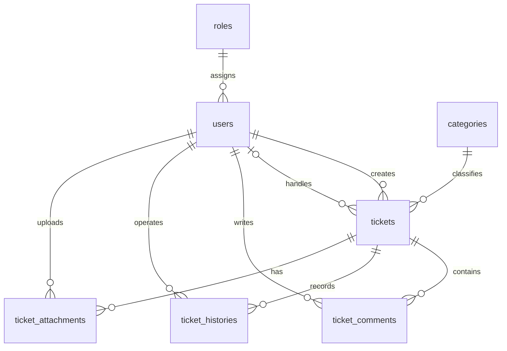

# FlowDesk 数据库设计文档

版本：v1.4（同步附件模块与当前后端实现）\
依据：PRD v1.3\
技术基线：MySQL 8.0（建议 8.0.16+；当前开发环境曾在 MySQL 8.4.13 验证）、SQLAlchemy 2.x、Alembic，数据库 `flowdesk`
修订日期：2026-11-25

## 1. 数据库设计说明

采用 InnoDB、`utf8mb4`、`utf8mb4_0900_ai_ci`（MySQL 8 专用排序规则），当前业务模型包含七张核心业务表：`roles`、`users`、`categories`、`tickets`、`ticket_comments`、`ticket_histories` 和 `ticket_attachments`。Alembic 自身的版本元数据表不计入业务表数量。

原六张核心表以 2026-11-20 从现有 `flowdesk` 数据库导出的结构快照为基线；附件表由后续 Alembic migration 引入。表名和字段名采用 snake_case。所有主键均为 `BIGINT UNSIGNED AUTO_INCREMENT`，对应外键整数统一使用 `BIGINT UNSIGNED`，不得混用有符号类型。时间字段统一为秒精度 `DATETIME`，不使用微秒精度版本。`updated_at` 使用 `DEFAULT CURRENT_TIMESTAMP ON UPDATE CURRENT_TIMESTAMP`。

MySQL `DATETIME` 本身不携带时区信息，本文约定所有业务时间按 UTC 解释。应用连接 MySQL 时应将会话 `time_zone` 设置为 `+00:00`，并以 UTC 写入和读取。API 时间应输出带 `Z` 的 ISO 8601 UTC 字符串。工单编号业务日期默认使用 UTC。

必填字符串由服务端校验非空白和长度。用户名统一为 3～50 位小写 ASCII 字母、数字、下划线，入库前去除首尾空格并转小写。角色判定以 `roles.code` 为准，不依赖自增 ID。所有外键采用 `ON DELETE RESTRICT ON UPDATE RESTRICT`，避免破坏历史关联。

表中“—”表示没有默认值。

## 2. roles 表设计

| 字段 | 类型 | 可空 | 默认值 | 约束及说明 |
| --- | --- | --- | --- | --- |
| id | BIGINT UNSIGNED | 否 | AUTO_INCREMENT | PK；内部主键 |
| name | VARCHAR(50) | 否 | — | 角色名称 |
| code | VARCHAR(30) | 否 | — | UNIQUE；角色代码 |
| created_at | DATETIME | 否 | CURRENT_TIMESTAMP | 创建时间 |

预置 ADMIN、AGENT、USER。初始化时按 `code` 幂等查找或插入，不开放角色管理。原数据库和独立测试库的自增 ID 可能不同，业务逻辑不得依赖角色 ID 顺序。

## 3. users 表设计

| 字段 | 类型 | 可空 | 默认值 | 约束及说明 |
| --- | --- | --- | --- | --- |
| id | BIGINT UNSIGNED | 否 | AUTO_INCREMENT | PK；内部主键 |
| username | VARCHAR(50) | 否 | — | UNIQUE；登录账号 |
| password_hash | VARCHAR(255) | 否 | — | Argon2id 密码哈希 |
| display_name | VARCHAR(100) | 否 | — | 显示名称 |
| role_id | BIGINT UNSIGNED | 否 | — | FK → roles.id；角色 |
| created_at | DATETIME | 否 | CURRENT_TIMESTAMP | 创建时间 |
| updated_at | DATETIME | 否 | CURRENT_TIMESTAMP | 更新时间；`ON UPDATE CURRENT_TIMESTAMP` |

公开注册仅创建 USER；管理员入口创建 AGENT；首个 ADMIN 由安全初始化流程创建。注册 DTO 不提供角色写入字段，发现多余 `role`、`role_id` 字段应拒绝。应用按 `roles.code` 查询角色 ID。

密码哈希必须是真实 Argon2id 算法输出。现有开发数据中若仍有 `zhangsan` 的演示占位哈希 `demo_hash_not_a_real_password`，不得将其视为有效凭证。初始化脚本不得覆盖已有管理员密码。当前字段不含账号禁用标记，禁用功能不属于 MVP。

## 4. categories 表设计

| 字段 | 类型 | 可空 | 默认值 | 约束及说明 |
| --- | --- | --- | --- | --- |
| id | BIGINT UNSIGNED | 否 | AUTO_INCREMENT | PK；内部主键 |
| name | VARCHAR(50) | 否 | — | UNIQUE；分类名称 |
| description | VARCHAR(255) | 是 | NULL | 分类描述 |
| created_at | DATETIME | 否 | CURRENT_TIMESTAMP | 创建时间 |

预置网络问题、设备故障、软件问题、账号问题、其他问题。初始化时按 `name` 幂等写入，不开放分类增删改。工单必须选择一个存在的分类；外键阻止不存在的分类 ID。

## 5. tickets 表设计

| 字段 | 类型 | 可空 | 默认值 | 约束及说明 |
| --- | --- | --- | --- | --- |
| id | BIGINT UNSIGNED | 否 | AUTO_INCREMENT | PK；内部主键 |
| ticket_no | VARCHAR(32) | 否 | — | UNIQUE；不可变业务编号 |
| title | VARCHAR(200) | 否 | — | 工单标题 |
| description | TEXT | 否 | — | 工单描述 |
| priority | VARCHAR(16) | 否 | NORMAL | LOW、NORMAL、HIGH |
| status | VARCHAR(20) | 否 | OPEN | OPEN、ASSIGNED、IN_PROGRESS、RESOLVED、CLOSED |
| creator_id | BIGINT UNSIGNED | 否 | — | FK → users.id；不可变创建人 |
| assignee_id | BIGINT UNSIGNED | 是 | NULL | FK → users.id；负责人 |
| category_id | BIGINT UNSIGNED | 否 | — | FK → categories.id；必填分类 |
| deleted_at | DATETIME | 是 | NULL | 逻辑删除时间 |
| created_at | DATETIME | 否 | CURRENT_TIMESTAMP | 创建时间 |
| updated_at | DATETIME | 否 | CURRENT_TIMESTAMP | 更新时间；`ON UPDATE CURRENT_TIMESTAMP` |

### 5.1 状态、优先级与 CHECK 约束

优先级：`LOW`、`NORMAL`、`HIGH`。状态：`OPEN`、`ASSIGNED`、`IN_PROGRESS`、`RESOLVED`、`CLOSED`。

当前服务定义的合法状态流转：

| 原状态 | 目标状态 | 允许角色 |
| --- | --- | --- |
| OPEN | ASSIGNED | ADMIN，通过分配操作并同时设置负责人 |
| ASSIGNED | IN_PROGRESS | 当前负责人 AGENT 或 ADMIN |
| IN_PROGRESS | RESOLVED | 当前负责人 AGENT 或 ADMIN |
| RESOLVED | CLOSED | 工单创建人 USER 或 ADMIN |

当前 MVP 不支持 `RESOLVED → IN_PROGRESS` 或 `CLOSED` 重新打开。`OPEN` 必须无负责人，其余状态必须有负责人。负责人必须具有 AGENT 角色，由服务端校验。

MySQL 8.0.16+ 使用 `CHECK` 校验状态、优先级枚举，以及状态与负责人组合：

```sql
CONSTRAINT chk_tickets_priority
    CHECK (priority IN ('LOW', 'NORMAL', 'HIGH')),

CONSTRAINT chk_tickets_status
    CHECK (status IN ('OPEN', 'ASSIGNED', 'IN_PROGRESS', 'RESOLVED', 'CLOSED')),

CONSTRAINT chk_tickets_assignee
    CHECK (
        (status = 'OPEN' AND assignee_id IS NULL)
        OR (status <> 'OPEN' AND assignee_id IS NOT NULL)
    )
```

CHECK 只能保证持久状态合法，不能保证“谁能转到哪个状态”。角色权限、负责人角色和状态流转必须由 FastAPI 服务端校验。

所有业务写操作应在事务内锁定工单（例如 `SELECT ... FOR UPDATE`），并在锁内重新检查权限、状态、负责人和 `deleted_at`。

### 5.2 工单编号

格式：`FD-YYYYMMDD-NNNNN`，例如 `FD-20261123-00001`。

**当前实现约定：**

1. `YYYYMMDD` 使用 UTC 日期生成。
2. 每日流水号从 `00001` 开始，固定五位，当前实现最大为 `99999`；达到上限时抛出当日编号耗尽错误，不自动扩展为六位。
3. 创建工单时使用 MySQL 命名锁 `GET_LOCK`。锁名按数据库标识和 UTC 日期区分，等待超时为 10 秒。
4. 命名锁由独立数据库连接持有，并在工单事务提交后释放；释放失败时应使连接失效，避免持锁连接回到连接池。
5. 持锁期间查询当天最后一个 `ticket_no`，生成下一个固定五位流水号。查询不排除逻辑删除工单，因此已删除编号不会复用。
6. `UNIQUE(ticket_no)` 是数据库最终唯一性约束。
7. 当前方案不使用独立的日期计数器表。若未来单日并发量明显提高，应通过真实 MySQL 压测评估锁等待和吞吐量，再决定是否升级方案。

说明：早期设计稿曾提出流水号超过 `99999` 后自动扩展为六位；当前服务代码实际在 `99999` 时抛出 `TicketNumberExhaustedError`。本版本以当前实现为准，自动扩展不属于当前 MVP 行为。

### 5.3 建议索引

- UNIQUE(`ticket_no`)
- INDEX(`creator_id`, `deleted_at`, `created_at`)
- INDEX(`assignee_id`, `deleted_at`, `status`, `created_at`)
- INDEX(`category_id`)
- INDEX(`deleted_at`, `status`, `created_at`)

标题包含式搜索暂不引入全文索引。实际索引效果通过 `EXPLAIN` 验证。

## 6. ticket_comments 表设计

| 字段 | 类型 | 可空 | 默认值 | 约束及说明 |
| --- | --- | --- | --- | --- |
| id | BIGINT UNSIGNED | 否 | AUTO_INCREMENT | PK；评论 ID |
| ticket_id | BIGINT UNSIGNED | 否 | — | FK → tickets.id |
| user_id | BIGINT UNSIGNED | 否 | — | FK → users.id；评论作者 |
| content | TEXT | 否 | — | 纯文本评论 |
| created_at | DATETIME | 否 | CURRENT_TIMESTAMP | 评论创建时间 |

有效工单仅创建人、当前负责人及管理员可访问评论。已关闭工单只读。已删除工单仅管理员可查看历史评论，任何角色均不得新增评论。正文非空白，不支持编辑和删除。按 `(created_at, id)` 排序。

建议索引：`INDEX(ticket_id, created_at, id)`、`INDEX(user_id)`。

## 7. ticket_histories 表设计

| 字段 | 类型 | 可空 | 默认值 | 约束及说明 |
| --- | --- | --- | --- | --- |
| id | BIGINT UNSIGNED | 否 | AUTO_INCREMENT | PK；历史记录 ID |
| ticket_id | BIGINT UNSIGNED | 否 | — | FK → tickets.id |
| operator_id | BIGINT UNSIGNED | 否 | — | FK → users.id；操作人 |
| action_type | VARCHAR(32) | 否 | — | 操作类型 |
| field_name | VARCHAR(32) | 否 | — | 变更字段 |
| old_value | JSON | 是 | NULL | 变更前值 |
| new_value | JSON | 是 | NULL | 变更后值 |
| created_at | DATETIME | 否 | CURRENT_TIMESTAMP | 操作记录时间 |

### 7.1 当前已观察到的 action_type

| action_type | field_name | 说明 |
| --- | --- | --- |
| CREATE | ticket | 创建工单；`new_value` 保存工单摘要对象。 |
| UPDATE | title、description、priority、category_id | 重要字段发生变化时逐字段记录。 |
| ASSIGN | assignee_id、status | 首次分配时分别写入负责人和状态两条记录。 |
| STATUS_CHANGE | status | 独立状态流转。 |
| TICKET_DELETED | deleted_at | 逻辑删除目标事件类型；须核对删除服务的实际实现后再标记为已验收。 |

创建工单时，当前代码会写入一条 `CREATE` 记录，`field_name` 为 `ticket`，`old_value` 为空，`new_value` 为摘要对象，至少包含 `ticket_no`、`title`、`priority`、`status`、`category_id`。

普通字段更新时，当前代码使用 `UPDATE`，每个实际变化字段单独一条记录；没有变化的字段不记录。首次分配时使用两条 `ASSIGN` 记录，分别记录 `assignee_id` 和 `status`。单独状态流转使用 `STATUS_CHANGE`。

`TICKET_DELETED` 是本设计要求的逻辑删除事件类型，但本次可见的服务代码摘录未包含工单删除服务，因此不能仅凭文档认定该事件已经实现；应检查实际删除服务和测试后确认。

### 7.2 JSON 值约定

- `old_value`、`new_value` 使用 MySQL JSON 类型。
- 状态、标题、描述、优先级保存为 JSON 字符串；负责人和分类 ID 保存为 JSON 数字；删除时间保存为 UTC ISO 8601 字符串。
- 业务空值统一按 SQL `NULL` 处理，API 表示为 `null`；不应混淆 SQL `NULL` 和 JSON `null`。
- SQLAlchemy 映射可评估使用 `JSON(none_as_null=True)`，并通过 MySQL 集成测试确认实际存储值。
- 每条记录只保存一个实际字段名；长文本字段如需保存完整旧值和新值，应确认接口权限与数据保留策略。
- 所有历史列表按 `(created_at, id)` 稳定排序；时间精度为秒，`id` 用于同秒排序。
- 工单变更和对应历史记录必须在同一数据库事务中完成，任何一步失败整体回滚。

建议索引：`INDEX(ticket_id, created_at, id)`、`INDEX(operator_id)`。

## 8. ticket_attachments 表设计

附件表由后续 Alembic migration 引入，不属于 2026-11-20 导出的六表 `schema.sql` 快照。

| 字段 | 类型 | 可空 | 默认值 | 约束及说明 |
| --- | --- | --- | --- | --- |
| id | BIGINT UNSIGNED | 否 | AUTO_INCREMENT | PK；附件 ID |
| ticket_id | BIGINT UNSIGNED | 否 | — | FK → tickets.id；所属工单 |
| uploader_id | BIGINT UNSIGNED | 否 | — | FK → users.id；上传用户 |
| original_filename | VARCHAR(255) | 否 | — | 清理后的原始文件名 |
| storage_key | VARCHAR(32) | 否 | — | 服务器内部存储标识；32 位小写十六进制 |
| content_type | VARCHAR(100) | 否 | — | 规范化 MIME 类型 |
| file_size | BIGINT UNSIGNED | 否 | — | 文件大小，单位字节 |
| created_at | DATETIME | 否 | CURRENT_TIMESTAMP | 上传时间 |
| deleted_at | DATETIME | 是 | NULL | 附件逻辑删除时间 |

关系：

- `ticket_id` → `tickets.id`，`ON DELETE RESTRICT ON UPDATE RESTRICT`。
- `uploader_id` → `users.id`，`ON DELETE RESTRICT ON UPDATE RESTRICT`。
- `storage_key` 应保证唯一；其格式由应用层校验，不允许客户端指定任意磁盘路径。
- 附件列表查询按工单过滤，并排除 `deleted_at IS NOT NULL` 的记录；建议索引覆盖 `(ticket_id, deleted_at, created_at, id)`。

**实施核对说明：** 上表是当前应用接口和附件模型所需的数据契约。精确字段类型、约束名称和索引名称，以 `alembic/versions/04361f1587f7_add_ticket_attachments.py` 及目标数据库 `SHOW CREATE TABLE ticket_attachments` 的结果为准。若迁移文件与本节不一致，应先核对实际模型和数据库，再同步修订文档；不得仅凭本文手工改表。

## 9. 文件存储与附件业务规则

### 9.1 文件系统存储

- 文件本体存放于 `backend/storage/attachments/`，不存入 MySQL。
- `storage_key` 由 `uuid4().hex` 生成，为 32 位小写十六进制字符串。
- 服务器根据经过格式校验的 `storage_key` 拼接文件路径，不接受客户端提供的物理路径。
- 上传时先写入同目录临时文件 `.storage_key.tmp`，完整写入后通过 `os.replace` 移动为正式文件。
- 每次读取 1 MiB，避免一次性把整个文件加载到内存。
- 文件大小上限为 10 MiB，即 `10 * 1024 * 1024` 字节。
- 文件名需去除路径信息、控制字符和首尾空格，最多保留 255 个字符。

### 9.2 文件类型验证

允许的扩展名：`.png`、`.jpg`、`.jpeg`、`.pdf`、`.txt`。

- 扩展名、声明 MIME 类型和实际内容必须匹配。
- PNG、JPEG、PDF 通过文件签名进行基础内容校验。
- TXT 必须为 UTF-8 编码，不允许 NUL 字节。
- 空文件不允许上传。
- MIME 类型为空时可按通用二进制类型进入服务端验证流程，但不能绕过扩展名和实际内容检查。

### 9.3 附件权限

所有附件操作先检查当前用户对所属工单的访问权限：

| 角色 | 可访问工单范围 |
| --- | --- |
| ADMIN | 全部未逻辑删除工单 |
| AGENT | 分配给自己的未逻辑删除工单 |
| USER | 自己创建的未逻辑删除工单 |

其他规则：

- 已删除工单的附件不允许通过普通附件接口访问。
- `CLOSED` 工单不允许上传新附件。
- ADMIN 可以删除任意附件；其他角色只能删除自己上传的附件。
- 附件列表按 `created_at`、`id` 升序分页；默认 `page_size=20`，最大 100。
- 下载必须通过鉴权接口返回 `FileResponse`，不得公开存储目录。
- 下载响应使用数据库保存的 MIME 类型和原始文件名，并设置 `X-Content-Type-Options: nosniff`。

### 9.4 附件删除和文件清理

1. 锁定附件记录并检查其未被逻辑删除。
2. 检查所属工单访问权限和附件删除权限。
3. 将 `ticket_attachments.deleted_at` 设置为 UTC 删除时间。
4. 提交数据库事务。
5. 数据库提交成功后再删除磁盘文件。
6. 若磁盘清理失败，记录日志；附件记录仍保持逻辑删除，不应重新出现在列表或下载接口中。

这是一种数据库记录与文件系统分阶段处理的策略，不能声称数据库事务可以原子回滚文件系统操作。生产环境应配置附件目录备份和孤儿文件巡检策略。

### 9.5 附件 API

| 方法 | 路径 | 说明 |
| --- | --- | --- |
| POST | `/api/v1/tickets/{ticket_id}/attachments` | 上传附件，成功返回 201 |
| GET | `/api/v1/tickets/{ticket_id}/attachments` | 分页查询附件 |
| GET | `/api/v1/attachments/{attachment_id}/download` | 下载附件 |
| DELETE | `/api/v1/attachments/{attachment_id}` | 删除附件，成功返回 204 |

常见错误：工单或附件不存在返回 404；无权访问返回 403；关闭工单上传返回 409；文件超过 10 MiB 返回 413；不支持的类型返回 415；空文件或内容校验失败返回 422。

## 10. 表关系与外键

所有关系均为一对多。工单负责人关系可空。



外键清单：

| 外键 | 引用字段 | 可空 |
| --- | --- | --- |
| users.role_id | roles.id | 否 |
| tickets.creator_id | users.id | 否 |
| tickets.assignee_id | users.id | 是 |
| tickets.category_id | categories.id | 否 |
| ticket_comments.ticket_id | tickets.id | 否 |
| ticket_comments.user_id | users.id | 否 |
| ticket_histories.ticket_id | tickets.id | 否 |
| ticket_histories.operator_id | users.id | 否 |
| ticket_attachments.ticket_id | tickets.id | 否 |
| ticket_attachments.uploader_id | users.id | 否 |

唯一约束：`roles.code`、`users.username`、`categories.name`、`tickets.ticket_no`；附件 `storage_key` 应唯一。所有外键采用 `ON DELETE RESTRICT`、`ON UPDATE RESTRICT`，避免误删历史数据。

## 11. 工单逻辑删除设计

仅 `tickets` 使用 `deleted_at`。`NULL` 表示有效，非 `NULL` 表示已删除。删除标记与 `status` 独立，不新增 `DELETED` 状态，不改变负责人或业务状态。

### 11.1 已删除工单权限

| 操作 | USER | AGENT | ADMIN |
| --- | --- | --- | --- |
| 查看列表、详情 | 否 | 否 | 是，可筛选 |
| 查看历史评论 | 否 | 否 | 是 |
| 查看操作记录 | 否 | 否 | 是 |
| 查看附件 | 否 | 否 | 不通过普通有效工单附件接口访问 |
| 修改基本信息 | 否 | 否 | 否 |
| 状态流转、分配 | 否 | 否 | 否 |
| 新增评论、附件 | 否 | 否 | 否 |
| 恢复、物理删除 | 否 | 否 | 否 |

普通用户和处理人员的列表、详情、评论及历史查询必须排除已删除工单，并执行原有权限校验。管理员默认查看有效工单，可通过筛选查看已删除工单及其历史评论和操作记录；已删除工单为只读。

### 11.2 删除事务

仅管理员可逻辑删除有效工单。设计要求是在同一事务中锁定工单、检查权限及删除标记、设置 `deleted_at`、插入删除历史。任一步失败整体回滚。删除时间与历史 `new_value` 必须表示同一时刻。

重复删除应幂等：管理员再次发出删除请求时响应成功，不覆盖原时间，不产生第二条删除历史。所有角色均不得恢复、修改或物理删除已删除工单。评论、历史、外键关系及编号全部保留。

**实现状态说明：** 当前可见的 `ticket_service.py` 代码摘录包含创建、更新、分配和状态流转服务，但没有展示工单逻辑删除服务。删除规则属于本设计基线，必须在检查实际删除服务和集成测试后，才能标记为已实现。删除事件目标 `action_type` 为 `TICKET_DELETED`、`field_name` 为 `deleted_at`。

## 12. 时间、事务和一致性约定

### 12.1 UTC 时间

- MySQL `DATETIME` 按 UTC 解释，精度为秒。
- MySQL 全局和连接会话时区应为 `+00:00`；连接池创建及复用连接时均须确保会话时区正确。
- 应用内部使用 UTC 时间；写入无时区信息的 `DATETIME` 前按项目约定转换为 UTC。
- API 应输出带 `Z` 的 ISO 8601 UTC 时间。
- 工单编号日期也使用 UTC。

**已知格式差异：** 已观察到的历史 API 样例为 `2026-11-24T05:32:43`，没有 `Z`。这与本节 API 输出约定不一致；需统一 Pydantic/响应序列化行为并增加 API 测试，不能仅凭数据库会话时区正确就认为 API 时间格式已验收。

### 12.2 事务

- 工单创建与 CREATE 历史在同一事务提交。
- 工单基本字段更新与对应 UPDATE 历史在同一事务提交。
- 首次分配的负责人、状态更新与两条 ASSIGN 历史在同一事务提交。
- 状态流转与 STATUS_CHANGE 历史在同一事务提交。
- 工单逻辑删除与删除历史应在同一事务提交（待核对实际删除服务）。
- 附件上传涉及文件系统和数据库，采用“先写临时文件、原子移动、再提交元数据；数据库失败时清理文件”的补偿策略。
- 附件删除采用“先提交数据库逻辑删除、再清理磁盘文件”的分阶段策略；文件系统操作不属于数据库事务。

## 13. 数据库快照、初始化与 Alembic 迁移

### 13.1 `database/schema.sql`

- 当前 `schema.sql` 是 2026-11-20 从原 `flowdesk` 数据库导出的六张基础业务表结构快照。
- 文件包含 `roles`、`users`、`categories`、`tickets`、`ticket_comments`、`ticket_histories` 六条核心表的建表结构。
- 该快照不包含 `ticket_attachments`，也不包含现有业务数据。
- 文件不包含 `CREATE DATABASE` 或 `USE`；执行前必须创建目标数据库并明确选择目标库。
- 它是结构快照，不是幂等迁移脚本；不得直接重复导入到已经存在这些表的数据库。

### 13.2 `database/seed.sql`

- 初始化 ADMIN、AGENT、USER 三种角色和五种工单分类。
- 使用 `utf8mb4`、UTC 会话时区和事务。
- 通过唯一键及 `ON DUPLICATE KEY UPDATE` 实现幂等初始化，不覆盖已有用户密码。
- 原数据库自增计数器可能导致独立测试库角色 ID 为 4～6、分类 ID 为 7～11；应用必须按角色 `code` 和分类名称查询，不得写死 ID。

### 13.3 附件 Alembic 迁移

- 附件表由 `alembic/versions/04361f1587f7_add_ticket_attachments.py` 引入。
- 因此，旧版六表 `schema.sql` 不能单独代表当前七表结构。
- 新环境初始化时，应先准备六张基础表和初始化数据，再依据项目 Alembic 版本状态执行附件迁移（通常通过 `alembic upgrade head`）。执行前核对目标库是否已存在附件表及 Alembic 版本记录，避免重复创建。
- 对已有数据库建立迁移基线或补录版本时，必须先核对实际结构；严禁未经核对就执行会重复创建表的自动生成迁移。
- 迁移文件、ORM metadata 和 MySQL `SHOW CREATE TABLE` 三者应保持一致。

## 14. 验证清单与当前实施状态

### 14.1 数据库与业务规则验证

- [ ] 唯一字段重复值被数据库拒绝。
- [ ] 缺失分类及无效外键被拒绝；分类 ID 必须存在。
- [ ] `OPEN` 状态允许 `assignee_id` 为 NULL，其余状态必须有负责人。
- [ ] 非法状态、优先级及状态/负责人组合被数据库 CHECK 约束拒绝。
- [ ] 工单编号命名锁、锁超时、唯一索引和每日 99999 上限符合当前实现。
- [ ] 并发创建工单时编号唯一；已删除编号不复用。
- [ ] CREATE、UPDATE、ASSIGN、STATUS_CHANGE 历史记录字段和值符合约定。
- [ ] 多字段修改逐字段记录，无变化字段不记录。
- [ ] JSON 类型及 SQL NULL/JSON null 约定正确。
- [ ] 事务失败时工单与历史一并回滚。
- [ ] 已删除工单权限符合管理员只读规则；重复删除不重复写入历史。
- [ ] 附件表结构与 Alembic migration、ORM model 一致。
- [ ] 附件上传、下载、列表和删除的角色权限符合第 9 节。
- [ ] 文件扩展名、MIME、内容签名、UTF-8 TXT 和 10 MiB 大小限制通过边界测试。
- [ ] 数据库逻辑删除与磁盘文件清理失败场景均有测试或可观测日志。
- [ ] UTC 数据库存储、连接会话时区和 API `Z` 输出一致。

### 14.2 当前已知开发状态

截至 2026-11-25 的开发记录：

- 六张基础表的结构快照 `database/schema.sql` 和初始化脚本 `database/seed.sql` 已生成。
- 附件表通过 Alembic migration 引入；附件上传、列表、下载、删除接口已在 OpenAPI 中注册。
- 附件存储使用本地文件系统，存储目录为 `backend/storage/attachments/`。
- 本地自动化测试记录为 `147 passed`，另有一条 Starlette/httpx 弃用警告；该记录不等同于生产部署验收。

仍需明确核对：

1. `ticket_attachments` 实际字段类型、索引和约束名称，以迁移文件和 `SHOW CREATE TABLE` 为准。
2. 工单逻辑删除服务是否已实现，以及删除历史实际使用的 `action_type`。
3. API 时间序列化是否已补充 `Z`；目前观察到的响应样例未带 `Z`。
4. 生产环境的数据库备份、附件目录备份、恢复演练和文件清理巡检。

## 15. 修订记录

| 版本 | 内容 |
| --- | --- |
| v1.0 | 六张基础表初始字段设计。 |
| v1.1 | JSON 历史值、重要字段审计、删除审计及管理员只读访问已删除工单。 |
| v1.2 | 将主外键、时间精度及字段长度与现有 MySQL 对齐；同步 PRD；明确 JWT、UTC、编号方案、CHECK 和建表顺序。 |
| v1.3 | 同步六张基础表已创建的实际进度；补充 schema.sql、seed.sql、独立测试库及初始化验收结果。 |
| v1.4 | 增加 ticket_attachments 表和本地文件存储设计；同步附件接口、权限、类型和大小限制；修正操作历史 action_type；按当前代码明确工单编号命名锁与每日五位上限；标注 UTC API 格式和工单删除审计的待核对项。 |

同步状态：本文件 v1.4 以 PRD v1.3 为依据，纳入七张业务表的当前设计。六张基础表由 schema.sql 快照描述，附件表由 Alembic migration 描述。文档中已明确区分已观察到的实现与仍需检查的实现要求，不将未核实事项标记为已完成。
